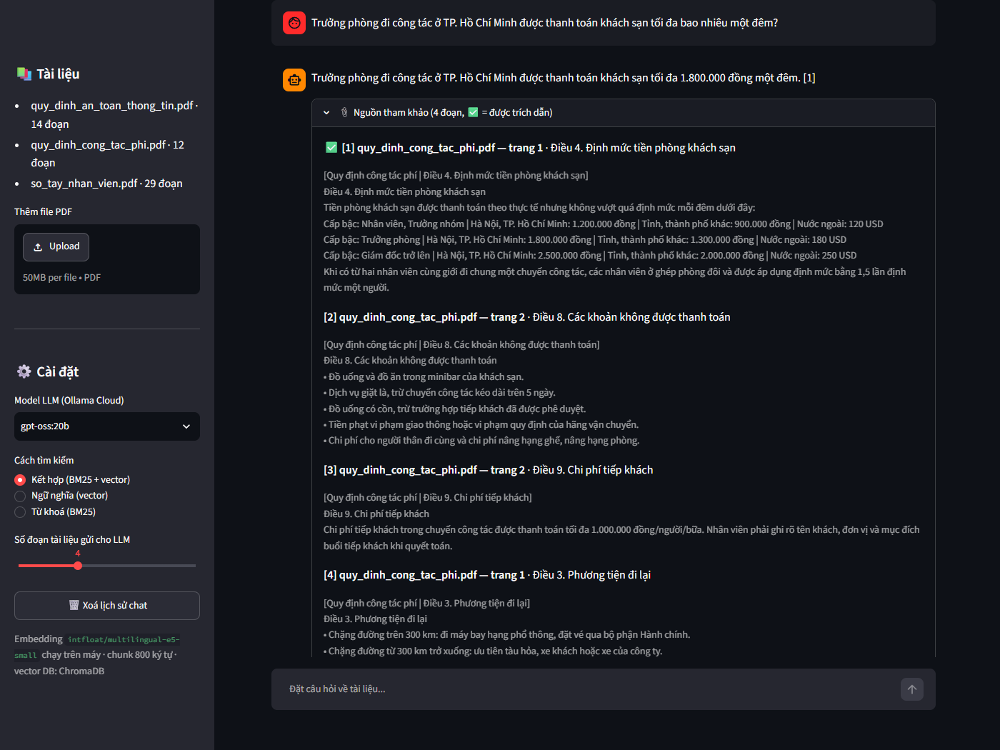
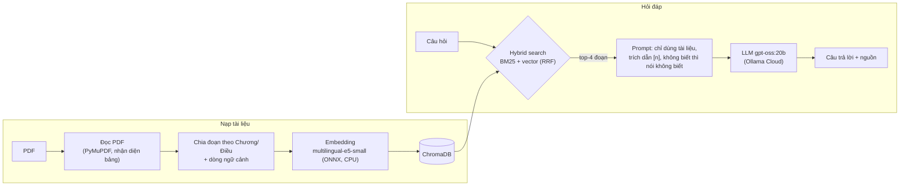

# 📄 Chatbot hỏi đáp tài liệu nội bộ (RAG tiếng Việt)

Chatbot trả lời câu hỏi của nhân viên dựa trên các tài liệu PDF nội bộ (sổ tay nhân viên, quy định công tác phí,
quy định an toàn thông tin...), **kèm trích dẫn nguồn (tên file, số trang)** và **từ chối trả lời khi tài liệu
không có thông tin** thay vì bịa.



## Điểm nổi bật

- **Pipeline RAG tự xây từng bước**, không dùng framework như LangChain: đọc PDF → chia đoạn → embedding →
  vector DB → tìm kiếm → prompt → LLM.
- **Tìm kiếm hybrid:** kết hợp BM25 (từ khoá) và vector (ngữ nghĩa) bằng Reciprocal Rank Fusion.
- **Chia đoạn theo cấu trúc văn bản** (Chương/Điều), mỗi đoạn có thêm dòng ngữ cảnh `[Tài liệu | Điều ...]`.
- **Đọc đúng bảng trong PDF:** mỗi hàng của bảng được viết lại kèm tên cột, tránh LLM ghép nhầm cột.
- **Đánh giá bằng số liệu:** 42 câu hỏi, đo Hit@k/MRR cho phần truy xuất, dùng LLM-as-a-judge cho câu trả lời,
  có phân tích lỗi và cải tiến prompt dựa trên kết quả.
- **Nhẹ:** embedding chạy bằng ONNX trên CPU (không cần GPU, PyTorch hay Docker), LLM gọi qua Ollama Cloud.
  Mọi model, cache và dữ liệu đều nằm trong thư mục dự án.

## Kết quả

Đánh giá tự động trên 42 câu hỏi (36 câu có đáp án trong tài liệu, 6 câu không có) bằng
`python eval/run_eval.py`:

| Chỉ số | LLM không RAG | RAG (cấu hình mặc định) |
|---|---|---|
| Trả lời đúng ý chính (36 câu) | 6% | **100%** |
| Từ chối đúng khi tài liệu không có thông tin (6 câu) | 67% | **100%** |
| Số câu bịa đặt (trên 42 câu) | 15 | **0** |
| Có trích dẫn nguồn | 0% | **100%** |
| Thời gian trả lời trung bình | 1,3 s | 1,3 s (LLM) + khoảng 8 ms tìm kiếm |

Các thí nghiệm khác:

- **Model embedding:** `multilingual-e5-small` tìm đúng đoạn ở vị trí đầu tiên (Hit@1) với 100% số câu hỏi,
  so với 69% của `paraphrase-multilingual-MiniLM-L12-v2`. Với model yếu hơn này, tìm kiếm hybrid nâng Hit@1
  từ 69% lên 83%.
- **Cách chia đoạn:** chia theo Chương/Điều kèm dòng ngữ cảnh đạt Hit@1 100%, so với 92% khi cắt cố định
  800 ký tự.
- **Cải tiến prompt sau phân tích lỗi:** tỉ lệ câu trả lời nêu đủ điều kiện/ngoại lệ quan trọng tăng từ 16%
  lên 42%, độ chính xác giữ nguyên 100%.
- **Lỗi đọc bảng** (bot trả lời 1.300.000 thay vì 1.800.000 đồng vì ghép nhầm cột) được phát hiện khi chạy thử
  và sửa bằng cách viết lại mỗi hàng của bảng kèm tên cột.

Chi tiết từng thí nghiệm và từng câu hỏi: [eval/results/report.md](eval/results/report.md).

## Kiến trúc



## Công nghệ

| Thành phần | Công cụ | Ghi chú |
|---|---|---|
| Đọc PDF | PyMuPDF | trích văn bản theo khối, nhận diện bảng |
| Embedding | fastembed + `intfloat/multilingual-e5-small` | ONNX trên CPU, khoảng 470 MB, hỗ trợ tiếng Việt |
| Vector DB | ChromaDB | lưu trên đĩa tại `data/chroma/` |
| Tìm theo từ khoá | rank-bm25 | âm tiết + cặp âm tiết (vd. `nghỉ_phép`) |
| LLM | `gpt-oss:20b` qua Ollama Cloud | dùng được với gói miễn phí |
| Giao diện | Streamlit | chat, tải PDF, chọn model và cách tìm kiếm |
| Đánh giá | `eval/run_eval.py` (tự viết) | giám khảo `gemma4:31b`, khác họ với model sinh câu trả lời |

## Cài đặt và chạy

Yêu cầu: Python 3.10 trở lên (đã chạy thử trên Python 3.14, Windows 11) và một API key Ollama
(tạo miễn phí tại <https://ollama.com/settings/keys>).

```bash
git clone <địa chỉ repo> && cd vietnamese-rag-chatbot
python -m venv .venv
.venv\Scripts\activate              # macOS/Linux: source .venv/bin/activate
pip install -r requirements.txt
copy .env.example .env              # macOS/Linux: cp .env.example .env — rồi điền OLLAMA_API_KEY
python ingest.py                    # nạp 3 PDF mẫu; lần đầu tải model embedding vào .cache/
streamlit run app.py                # mở http://localhost:8501
```

Các lệnh khác:

| Lệnh | Tác dụng |
|---|---|
| `python ask.py "Tôi được nghỉ phép bao nhiêu ngày?"` | hỏi nhanh từ dòng lệnh |
| `python eval/run_eval.py` | chạy lại toàn bộ đánh giá (thêm `--retrieval-only` để không gọi API) |
| `python -m pytest` | chạy kiểm thử (test giao diện cần API key và đã chạy `ingest.py`) |
| `python scripts/make_sample_docs.py` | tạo lại 3 PDF mẫu |

Muốn hỏi đáp tài liệu của bạn: tải PDF lên ở thanh bên trái của giao diện, hoặc chép file vào `data/docs/`
rồi chạy `python ingest.py`. Các tuỳ chọn (model, kích thước đoạn, top-k...) chỉnh trong `.env`.

## Cấu trúc thư mục

```
├── app.py                 # giao diện chat (Streamlit)
├── ingest.py              # nạp PDF vào vector DB
├── ask.py                 # hỏi nhanh từ dòng lệnh
├── rag/
│   ├── config.py          # cấu hình và đường dẫn (mọi thứ nằm trong thư mục dự án)
│   ├── loader.py          # đọc PDF, chuẩn hoá Unicode, xử lý bảng, bỏ header/footer
│   ├── chunker.py         # chia đoạn theo Chương/Điều + dòng ngữ cảnh
│   ├── embedder.py        # embedding bằng fastembed (ONNX)
│   ├── store.py           # lưu và tìm vector bằng ChromaDB
│   ├── retriever.py       # tìm kiếm BM25, vector, hybrid (RRF)
│   ├── llm.py             # gọi Ollama Cloud, thông báo lỗi dễ hiểu
│   └── pipeline.py        # ghép các bước, prompt
├── eval/
│   ├── questions.json     # 42 câu hỏi đánh giá kèm đáp án chuẩn
│   ├── run_eval.py        # script đánh giá
│   └── results/           # report.md, details.json
├── tests/                 # kiểm thử xử lý văn bản và kiểm thử E2E giao diện
├── scripts/make_sample_docs.py
├── data/docs/             # 3 PDF mẫu
└── docs/screenshot.png
```

## Hạn chế và hướng phát triển

- **Bộ dữ liệu nhỏ** (3 PDF, 8 trang, 42 câu hỏi): mỗi câu tương đương khoảng 2,8 điểm phần trăm, nên các
  con số mang tính minh hoạ. Cần đánh giá thêm trên bộ tài liệu thật, lớn hơn.
- **Câu trả lời đôi khi vẫn bỏ sót điều kiện phụ** (đầy đủ chi tiết mới đạt 42%). Có thể thử thêm ví dụ mẫu
  (few-shot) vào prompt.
- **Giám khảo là LLM** nên có thể chấm sai; một phần kết quả chấm đã được kiểm tra lại thủ công.
- **Chưa hiểu câu hỏi nối tiếp** ("còn trưởng phòng thì sao?") vì mỗi câu hỏi được tìm kiếm độc lập.
  Hướng sửa: viết lại câu hỏi dựa trên lịch sử chat trước khi tìm kiếm.
- **PDF dạng ảnh scan** cần OCR trước khi nạp.
- Có thể thử thêm reranker (cross-encoder) và tách từ tiếng Việt cho BM25.

## Về dữ liệu mẫu

3 tài liệu trong `data/docs/` thuộc về một **công ty hư cấu** ("Lam Tinh"), được tạo bằng
`scripts/make_sample_docs.py`. Mọi tên, số liệu và email đều không có thật. Dùng tài liệu hư cấu là có chủ
đích: LLM chắc chắn chưa từng thấy nội dung này khi huấn luyện, nên mọi câu trả lời đúng đều nhờ truy xuất
tài liệu chứ không phải nhờ "học thuộc".
